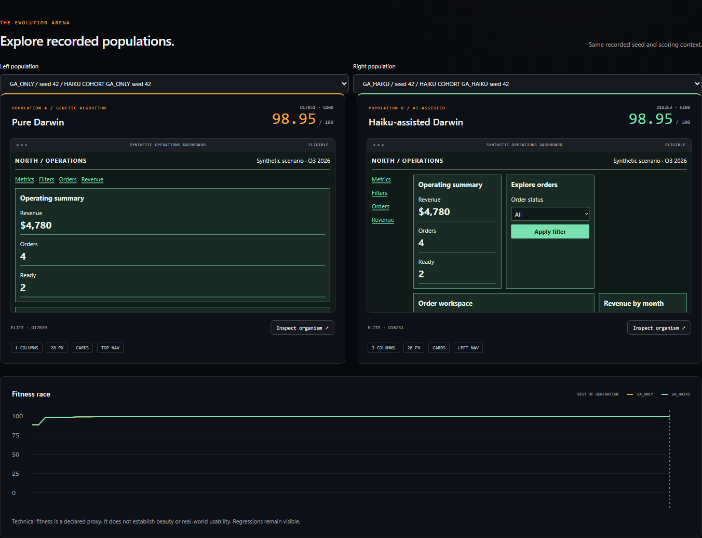
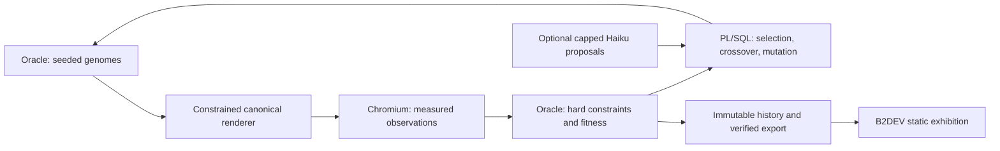

# APEX Genesis

**Can a database evolve its own user interface?**

*Interfaces are born. The database decides who survives.*

An experimental interface evolution laboratory built with Oracle APEX, PL/SQL,
and optional AI-guided mutation. By **Geraldo Viana Jr. / B2DEV TECH**.

[](https://b2dev.tech/blog/apex-genesis-evolving-interfaces-plsql-claude)

[Interactive exhibition](https://b2dev.tech/genesis/index.html) ·
[Engineering article](https://b2dev.tech/blog/apex-genesis-evolving-interfaces-plsql-claude) ·
[5:47 demonstration](https://b2dev.tech/media/videos/apex-genesis/v0.1.0-alpha.1/apex-genesis-demo.mp4) ·
[Installation](docs/installation/README.md) · [Recorded results](experiments/published-results/README.md)

## What actually runs

Oracle owns seeded initialization, parent selection, crossover, mutation, elitism,
diversity monitoring, immutable genomes, lineage, evaluation leases and generation
boundaries. A Node/Playwright worker measures real synthetic dashboards at three
viewport sizes. The native APEX application controls and inspects the experiment.
The public exhibition replays verified static exports, independently of Oracle.

This alpha includes a real **five-seed, 100-generation comparison of Pure Darwin,
Haiku-assisted Darwin and random search: 15 runs and 18,180 candidate records**.
All five Darwin/Haiku pairs tied at **98.95** final best-so-far. Haiku made **100
actual requests**, with 100 validated proposals; usage-derived cost **USD 0.0061064**.
No final-score benefit was observed. This is a proxy result, not a usability study.
The separate original offline pilot remains archived. AI is **disabled by default**
on installation. [Full comparison](experiments/published-results/HAIKU.md) |
[Release limits](docs/releases/v0.1.0-alpha.1.md) |
[Claude operational handoff](docs/operations/CLAUDE_HANDOFF.md).

## A database-owned evolutionary loop



Eleven bounded genes describe section order, columns, navigation, chart/order
representations, palette, typography, spacing, radius, disclosure and sorting.
Required metrics, filters, revenue and orders stay present. There is no generated
executable code. [Formal schema](evolution/genome-schema/genome.schema.json).
Organism identity, run, parents and mutations are stored separately from the
deduplicated SHA-256 phenotype.

Tournament selection defaults to three competitors, with two immutable elites.
Crossover transfers compatible traits, including section permutation as a single
gene. Bounded retries and immigrants limit identical offspring. Random search uses
the same starting population and candidate budget without parent selection.

## Fitness is an explicit proxy

Hard gates enforce grammar, required content, contrast, text size, names, focus and
responsive geometry. Eligible candidates receive a weighted score: accessibility
40%, hierarchy 25%, responsiveness 25%, and DOM-size performance proxy 10%.
Actual browser rendering time is recorded separately and does not affect selection.
Full axe audits cover release fixtures, not every candidate.

The score does **not** establish beauty, task completion or general usability.
Winning organisms often prefer large text and a long single-column composition,
exposing an unmeasured scrolling cost. [Exact rules and limitations](docs/research/methodology.md).

## Recorded Haiku comparison

Five paired final Darwin/Haiku scores tied at 98.95, with zero mean final advantage
for Haiku. Real provider usage: 100 requests, 33,299 input and 5,553 output tokens;
usage-derived cost USD 0.0061064. All 100 proposals were validated and map to exact
recorded offspring. No invoice, significance or real usability claim.
[Complete comparison](experiments/published-results/HAIKU.md) and
[immutable manifest](showcase/datasets/haiku-paired/manifest.json).

## Original offline pilot

| Seed | Darwin final best-so-far | Random search | Difference |
| --- | ---: | ---: | ---: |
| 42 | 98.9500 | 98.2846 | 0.6654 |
| 137 | 98.9500 | 98.1500 | 0.8000 |
| 3107 | 98.9500 | 97.3500 | 1.6000 |
| 7729 | 98.9500 | 98.6000 | 0.3500 |
| 201026 | 98.9500 | 97.2500 | 1.7000 |

Mean paired difference: **1.0231 points**, descriptive only. No significance claim.
Each run has 1,212 candidate slots, including generation zero. Repeated phenotypes
can reuse measurements; equal slots do not mean equal unique browser work or cost.
Best-of-generation regressions remain visible separately from historical best.
These runs made **zero provider requests, used zero model tokens and incurred zero
direct API cost**. Improvement per dollar is undefined for the offline comparison.

The [dataset manifest](showcase/datasets/pilot/manifest.json), [analysis](experiments/published-results/analysis.json)
and original engine commit `be49b9d` preserve provenance. The current engine 1.1.0
adds controls and safety fixes; the original runs remain labeled 1.0.0.

## Try the exhibition without Oracle

```powershell
npm ci
node scripts/verify-export.mjs
npm run serve
```

Open `http://127.0.0.1:4173`. Play, pause, scrub generations, inspect desktop/tablet/
mobile organisms, explore a family window, compare parent and offspring, and read
the recorded analytics. No database connection or API key is used. The same renderer
serves the public site, native lab and browser evaluation.

## Install the Oracle laboratory

Tested on **Oracle AI Database 26ai Free 23.26.3.0.0 and APEX 26.2.0**, with SQLcl
26.3 thin mode, Node 22.16 and Chromium 141.0.7390.37 on Windows. Other versions
are unverified. Use a dedicated schema/workspace with the documented grants.

1. Run `installer/install.sql` as the dedicated owner, **from the installer directory**.
2. Import [APEXlang source](apex/application) with SQLcl, or the actual [SQL export](apex/export/f120.sql)
   with destination overrides. Source app ID 120 is not a destination requirement.
3. Assign the intended APEX account a Genesis principal role.
4. Create ignored local worker configuration and start a small experiment:

```powershell
npx playwright install chromium
node scripts/run-experiment.mjs --mode=GA_ONLY --seed=42 --size=12 --generations=5
```

Follow the [complete installation and troubleshooting guide](docs/installation/README.md).
APEX scheduling does not replace the browser measurement worker. Evolution can run
without an open tab, but the worker must supply observations.

## Optional Haiku

The owner supplies an APEX Web Credential, verifies the runtime model and pricing,
and explicitly enables a capped run. Run/daily reservations, token ceilings,
single concurrency, zero automatic retries, uncertain-charge retention and Stop AI
are implemented before paid execution. Routine tests never call Anthropic.

Official documentation reviewed on 2026-10-20 listed `claude-haiku-5-5`; runtime
availability must still be checked. Prices are owner-reviewed snapshots, not fixed
assumptions. [Setup, limits and provider verification status](docs/installation/haiku.md).
The open-source adapter calls a proprietary hosted service; no other provider is
implemented in this alpha.

## Evidence and contribution

- [Architecture](docs/architecture/design.md), [related work](docs/research/related-work.md),
  [methodology](docs/research/methodology.md) and [security boundaries](docs/security/threat-model.md).
- [Verification evidence](docs/testing/evidence.md), [maintenance](docs/installation/maintenance.md)
  and [community contribution summary](docs/publication/community-contribution.md).
- Native lab pages: Control Center, Arena, Family Tree, Time Machine, Competition,
  Mutation Microscope, Research Analytics and Configuration. Remaining scope is
  disclosed in the release report.
- Real video: 1920×1080 H.264/AAC, English captions and identified local synthetic
  narration. Raw recordings and credentials are excluded from Git.

Original source and assets are Apache-2.0. Generated Oracle components retain their
applicable notices; see [NOTICE](NOTICE). This independent community experiment has
no Oracle or Anthropic endorsement. See [CONTRIBUTING](CONTRIBUTING.md) and [SECURITY](SECURITY.md).
