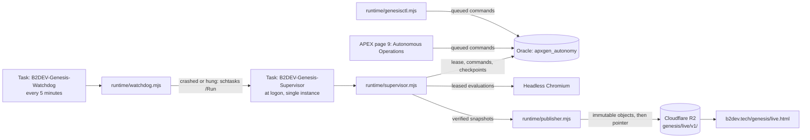

# Autonomous operation

APEX Genesis can run unattended on one Windows workstation. It runs bounded, seeded
experiments one after another and publishes each generation to the public live
archive only after the generation is complete and the published files are verified.
Each experiment is finite: 100 generations of 12 organisms by default. The laboratory
starts the next experiment only while its policy, daily cap and storage budget allow it.
It does not run forever, and it never spends money.

## Components



| Component | Responsibility |
|---|---|
| `apxgen_autonomy` (PL/SQL) | Policy, admission (one active run, daily cap, cooldown, storage budget), deterministic seeds, independent-then-lineage sequencing, stagnation action, supervisor lease, command queue, publication ledger, operations log. |
| `runtime/supervisor.mjs` | The only evaluator for autonomous runs. It holds the Oracle lease, applies queued commands, starts or resumes runs, evaluates leased organisms in a recycled headless browser, writes checkpoints, samples resources and calls the publisher. |
| `runtime/publisher.mjs` | Builds hashed snapshots of completed generations, uploads immutable objects, verifies them over public HTTPS, then moves the small `latest.json` pointer. |
| `runtime/watchdog.mjs` | Reads the local heartbeat and the Oracle supervisor row. It restarts the supervisor task only after a crash or a hang, never after a requested shutdown, and at most 3 times per hour. |
| `runtime/genesisctl.mjs` | Operator CLI. It uses the same command queue as the APEX panel. |
| APEX page 9 | Authenticated operations panel: status, warnings, publications, log and commands. Oracle requires the OPERATOR role for every operations callback. |
| `genesis-site/public/genesis/live.*` | Static public live archive. It reads only published, digest-verified JSON and never connects to Oracle. |

Nothing else runs. There is no Docker, broker, queue server or extra scheduler. The
Oracle job `APXGEN_AUTONOMY_TICK` only records admission state; it does not evaluate.
No language-model call is needed for a generation.

## Scheduled tasks

`scripts/install-tasks.ps1` registers two tasks for the current user:

| Task | Trigger | Settings |
|---|---|---|
| `B2DEV-Genesis-Supervisor` | At logon of the installing user | IgnoreNew, no time limit, BelowNormal priority, restart on failure 3 × 1 min |
| `B2DEV-Genesis-Watchdog` | Every 5 minutes | IgnoreNew, 2-minute limit, BelowNormal priority |

Both tasks run as the installing user with the limited run level. They never run as
SYSTEM and store no password. The script first tries S4U, which runs whether or not
the user is logged on. When Windows refuses S4U for a standard user, it falls back to
Interactive and starts node through `conhost.exe --headless`, so no window appears.
On the reference workstation the fallback was used: **the lab runs only while the
user is signed in.** The tasks do not wake the computer. They do not change sleep,
hibernation or the power plan. Only these two tasks may run on battery.

The task definitions contain no secrets. Database credentials stay in the ignored
`.local/oracle.json` file and are read at run time.

## Default policy

The policy lives in `APXGEN_AUTONOMY_CONFIG`. Change it only through
`genesisctl configure`, which validates every key and logs who changed what.

| Setting | Default |
|---|---|
| Population mode | `GA_ONLY` (paid AI is fixed off: `paid_ai` has a check constraint of 0) |
| Population × generations | 12 × 100 |
| Research policy | `INDEPENDENT_THEN_LINEAGE`: 5 independent seeded runs, then lineage runs that start from the previous run's final checkpoint |
| Seeds | Deterministic, derived from `base_seed` 20261020 and the run sequence |
| Active runs | At most 1 (check constraint) |
| Daily generation cap | 300 |
| Cooldown between runs | 600 s |
| Generation interval | 60 s |
| Stagnation | 25-generation window, action `CONTINUE` (`NEW_RUN` and `PAUSE` are available) |
| Storage budget | 440 MiB of the owner's 500 MiB quota |
| Run recoveries | A failed run continues as a new `RECOVERY` run from its last completed generation, at most 3 deep; then it is marked FAILED |
| Publication | Off at install. When enabled: check every 5 minutes, publish after 10 new completed generations (at most every 15 minutes) and on completion. The pointer heartbeat is refreshed every 20 minutes. |

The fitness definition is never rewritten by the autonomy layer. Every run records
its fitness definition and protocol version, and the live page compares best scores
only within one fitness definition.

When the storage budget or the daily cap is reached, the supervisor stops admitting
runs and reports the reason. It does not delete runs, checkpoints or published
history to make room. Raising the budget or archiving old runs is an owner decision.

## Recovery

* **Crash.** The Oracle lease expires after 90 s. The watchdog sees a stale
  heartbeat (more than 300 s), runs the supervisor task, and the new process takes
  over the lease. It resumes the active run from its last checkpoint. Organisms
  claimed by the dead process are reclaimed, and each one is evaluated once.
* **Duplicate start.** Task Scheduler ignores a second instance. A second process
  started by hand finds the local lock or the Oracle lease and exits with code 3.
* **Requested shutdown.** `shutdown` pauses the active run with
  `SUPERVISOR_SHUTDOWN`. It records the stop as deliberate, so the watchdog leaves it alone.
* **Failures.** The supervisor retries with backoff from 5 s to 300 s. After 8
  consecutive failures it stops safely and records the error.
* **Publication failure.** Nothing is moved until every new object is verified.
  A failed upload or a failed verification leaves the previous pointer in place,
  marks the attempt FAILED or ROLLED_BACK and retries with backoff up to 60 minutes.

## Publication format

Objects live in the `b2dev-media` R2 bucket under `genesis/live/v1/` and are served
from `https://b2dev.tech/media/genesis/live/v1/`.

| Object | Mutability |
|---|---|
| `runs/<runId>/progress-gNNNN-<sha12>.json` | Immutable. Contains only completed generations. |
| `runs/<runId>/final-<sha12>.json` | Immutable. Written once when the run completes. |
| `catalog/NNNNNN-<sha12>.json` | Immutable. Contains the run history and the current object of each run. |
| `latest.json` | The only mutable object. Contains the catalog key, its SHA-256, the laboratory state and the last sync time. |

The publisher uploads only to the allowlisted bucket and prefix. It scans every
document for secret-like keys and values before upload, and it never publishes
partially evaluated generations or data from a `TEST` run. The live page refuses
any file whose SHA-256 does not match the digest that referenced it.

## Commands

Run from the repository root. Every control command is queued in Oracle and applied
by the supervisor that holds the lease. The CLI waits up to 60 s and prints the result.

```powershell
# Install the tasks and start the supervisor (once)
powershell -NoProfile -ExecutionPolicy Bypass -File scripts/install-tasks.ps1

node runtime/genesisctl.mjs status            # full status; add --json for machines
node runtime/genesisctl.mjs start             # start the supervisor task now
node runtime/genesisctl.mjs pause             # pause the active run and stop admitting runs
node runtime/genesisctl.mjs resume            # resume the paused run
node runtime/genesisctl.mjs stop-run          # stop the active run for good (it stays archived; the next run follows after the cooldown)
node runtime/genesisctl.mjs disable           # turn autonomy off: the active run is paused and no run is admitted
node runtime/genesisctl.mjs enable            # turn autonomy on again; a run paused by disable resumes
node runtime/genesisctl.mjs publish           # publish verified progress now
node runtime/genesisctl.mjs shutdown --wait   # graceful supervisor stop; the watchdog will not restart it
node runtime/genesisctl.mjs log 50            # last 50 operations log lines
node runtime/genesisctl.mjs publications 20   # last 20 publication attempts
node runtime/genesisctl.mjs configure '{"publishEnabled":1}'

# Remove both tasks after a graceful shutdown (runs, checkpoints and publications are kept)
powershell -NoProfile -ExecutionPolicy Bypass -File scripts/uninstall-tasks.ps1
```

`run` starts the supervisor in the current console, which is useful for debugging.
Use it only while the task is stopped; the lease refuses a second supervisor anyway.

Existing installations apply migration 006 and recompile with
`scripts/upgrade-local.ps1`. That script reads the connection from
`APXGEN_CONFIG` (default `.local/oracle.json`) and passes it through stdin, never as
a command-line argument.

## Live archive

`https://b2dev.tech/genesis/live.html` shows the latest experiment and its laboratory
state: running locally, paused, awaiting evaluation, awaiting the next run, stopped,
last known or stale. The page shows the generation timeline, the rendered best
organism, the latest population, the lineage of the best, the run history and
recorded events. It also has an experiment selector and links to the recorded
archives. The original offline pilot and the Haiku comparison stay at
`/genesis/index.html` unchanged. The page becomes "stale" when the pointer has not
been refreshed for 45 minutes. This usually means the workstation is off or asleep.

The engineering article remains a historical record of the recorded experiment. It
is not rewritten by the autonomous lab.
