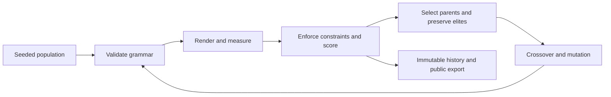

I wanted to give an Oracle database a problem that would be visible on the screen:
generate a population of interfaces, measure them, preserve some, and create the
next generation. The question was whether selection would produce better-scoring
interfaces than simply trying new random candidates.

APEX Genesis is the result: a PL/SQL evolutionary engine, an authenticated Oracle
APEX laboratory, and a public archive of the interfaces it actually produced.
The archive below contains five paired seeds and 100 generations per condition.
Its primary comparison is **Pure Darwin versus random search**. The optional
Claude mutation integration is implemented and tested with mocked responses;
this publication does not claim a completed paid Claude experiment.

<iframe src="/genesis/index.html" title="APEX Genesis: interactive recorded evolution laboratory" loading="eager" style="width:100%;height:85vh;min-height:620px;max-height:1000px;border:1px solid var(--border-subtle);border-radius:12px;background:#07090c" allow="fullscreen"></iframe>

*Recorded Oracle experiments. Play, scrub, inspect organisms, explore their
parents, and open the mutation microscope. [Open the exhibition at full size](/genesis/index.html).
No Oracle account, database connection or model credential is needed.*

## Why I attempted this

APEX is usually where I express an interface declaratively and connect it to
business rules. For this experiment I reversed the direction: the database
would propose bounded interface definitions, while the application would make
their evolution visible.

I was not trying to invent evolutionary design. Interactive evolutionary
computation has a long history, summarized in
[Takagi's 2001 survey](https://ieeexplore.ieee.org/iel5/5/20546/949485/949485.plain.html).
[SUPPLE](https://homes.cs.washington.edu/~weld/papers/kgajos-uist07.pdf) demonstrated
optimization-based generation of interfaces adapted to individual capabilities.
More recently, [FunSearch](https://www.nature.com/articles/s41586-023-06924-6)
combined language-model proposals with independent evaluation and evolutionary
search in a different problem domain.

Genesis explores a particular engineering combination: an Oracle-owned genetic
lifecycle, constrained interface genomes, a shared browser renderer, optional
budgeted model mutations, and an inspectable public history. That combination
is the contribution I can demonstrate. I make no claim that it is a world-first.

## Evolution without model training

A genetic algorithm does not need a neural network. It needs a representation,
a way to generate variation, and a rule for deciding what survives.

In Genesis, a generation contains twelve candidate interfaces. Tournament
selection samples possible parents. Compatible crossover combines their traits.
Mutation changes bounded values. Two elites carry successful phenotypes into
the next generation without editing their original genomes.



Random search uses the same initial population, scenario, renderer and scoring
rules. After generation zero it generates new candidates without evolutionary
parent selection. Its historical best is still preserved for analysis.

## Giving an interface a genome

The first organism is an operations dashboard with synthetic data. Every genome
must preserve four sections: metrics, filters, revenue and orders. Visitors can
use the status filter, inspect an order table or card representation, and change
preview size.

The genome has eleven bounded genes: column count, navigation position, section
permutation, chart type, order representation, palette, text size, spacing,
radius, notes disclosure and sort order. A phenotype might contain:

```json
{
  "schemaVersion": "1.0",
  "layout": {
    "columns": 3,
    "navigation": "top",
    "order": ["metrics", "filters", "revenue", "orders"],
    "chart": "bars",
    "table": "table"
  },
  "style": {"palette": 0, "fontSize": 16, "spacing": 16, "radius": 12},
  "behavior": {"collapseDetails": false, "sort": "name"}
}
```

This is a constrained grammar, not generated markup. Unknown properties,
unsupported types, missing sections, arbitrary URLs and code are rejected.
Changing a four-column arrangement into a single column or moving the filters
changes the actual composition of the dashboard.

Metadata is separate from phenotype. Oracle records the run, generation,
organism identity, creation method and parent relationships without duplicating
identical large genomes. Fixed-key canonical JSON receives a SHA-256 fingerprint.
The Oracle and browser implementations are tested against the same hashes.

The administrative application remains a normal APEX application. The evolving
organisms are rendered dashboards inside it; this release does not rewrite
APEX page definitions or customer applications.

## Building the engine in PL/SQL

The database owns the random state, candidate creation, immutable phenotypes,
parent edges, evaluation leases, generation summaries and lifecycle transitions.
The browser worker supplies observations; it does not choose parents or invent
offspring.

The seeded generator uses explicit Park–Miller integer state. The core operation
in the original experimental implementation is:

```sql
p_state := mod(p_state * 16807, 2147483647);
return floor((p_state - 1) / 2147483646 * p_limit);
```

The state before and after each generation is stored. That gives the random
sequence a durable boundary for inspection and checkpoint recovery. It is not
a promise that unrelated database versions or modified algorithms will produce
identical histories. Each published run identifies its implementation and
evaluation environment.

Uniform crossover transfers a complete section permutation as one gene. It
cannot splice two incompatible component trees because arbitrary trees are not
part of this first grammar. Duplicate offspring receive bounded mutation
retries, followed by a recorded immigrant when necessary.

`APXGEN_EVOLUTION` locks the run while creating a generation. Browser work uses
claim tokens and expiring leases. A late or forged token cannot overwrite a
completed observation. The engine advances only when all candidates are
terminal, and a failed evaluation has zero eligible fitness.

Checkpoint recovery creates a new run from a completed boundary. The original
history remains intact. `DBMS_SCHEDULER` can orchestrate generations without an
open tab, but rendered evaluation still requires the documented Node/Playwright
worker. A database cannot measure a Chromium layout by itself.

## Designing a fitness function I could explain

Hard constraints come before preferences. A candidate must preserve its required
sections and controls, meet the declared text and contrast thresholds, and pass
responsive geometry checks at **390, 768 and 1440 pixels**.

Eligible candidates receive a transparent weighted technical score:

| Objective | Weight | What it measures |
| --- | ---: | --- |
| Accessibility proxy | 40% | Palette contrast and declared readable text size; browser focus and naming checks are hard gates |
| Information hierarchy | 25% | Summary and filter positions, plus a declared spacing preference |
| Responsiveness | 25% | Measured overflow, clipping and section overlap at the three viewports |
| Performance proxy | 10% | Deterministic DOM-node cost for the complete required interface |

Actual synchronous render/layout time is recorded separately. I excluded it
from selection because operating-system scheduling noise would otherwise alter
the evolutionary path. DOM count is only a proxy; it is not a rendering-speed
benchmark or a substitute for interaction performance.

Release browser tests also run axe on representative real renderings and the
public exhibition. Those audits are separate from the per-candidate checks;
they do not certify every generated phenotype or establish full accessibility.

The hierarchy rule is deliberately simple. It expresses a task assumption,
not an objective law of design. A different scenario could reasonably prefer
another arrangement. Human preferences have separate storage and do not
silently change this primary score.

## Where Claude fits, and where it does not

The optional Haiku integration proposes one to three mutations within the same
grammar. It receives a compact synthetic parent genome and returns operations
such as changing spacing or section order. The independent validator and fitness
engine decide whether the resulting organism is eligible.

At the documentation review, Anthropic listed
[`claude-haiku-5-5`](https://platform.claude.com/docs/en/models/overview).
[Published pricing](https://platform.claude.com/docs/en/about-claude/pricing)
started at $0.10 per million input tokens and $0.50 per million output tokens
for the short-prompt tier. Those are documentation observations, not permanent
constants built into the spending logic.

Before a paid run, Genesis requires owner opt-in, a fresh model lookup, reviewed
pricing, a secure credential and run/daily limits. A reservation covers the
maximum permitted input and output before the request. Returned usage is
reconciled using that reservation's price snapshot. Uncertain charges remain
reserved; exhausted or uncertain budgets do not silently resume.

[APEX Web Credentials](https://docs.oracle.com/en/database/oracle/apex/26.2/htmdb/understanding-web-credentials.html)
keep the API key outside browser code and exports. Provider calls have bounded
timeouts, and automatic paid retries are disabled in this release.

An independent review caught a useful concurrency problem: the scheduler could
otherwise create the next generation while a model request was still running.
The corrected engine has a database-owned AI boundary. Due or in-flight proposals
hold offspring creation, and the external call runs without retaining the run
lock. A stale reservation becomes uncertain and stops further spending.

**There is no completed live Haiku result in this article.** Mocked tests verify
the spending and response boundaries, including two-worker races; they are not
evidence that Claude improves interface evolution. That hypothesis remains open.

## Experimental methodology

The offline protocol declared five paired seeds: **42, 137, 3107, 7729 and
201026**. Each condition used population 12 and 100 evolutionary advances after
generation zero. That is **1,212 candidate slots per run**, across ten runs.

Both conditions shared initialization, constraints, fitness, browser version,
viewport sizes and scenario. Genetic defaults were mutation 0.25, crossover
0.75, tournament size 3 and two elites. The primary comparison was final
best-so-far technical fitness.

Equal candidate slots do not mean equal unique browser work. Elites and repeated
phenotypes can reuse observations when their evaluation fingerprint matches.
The export reports cache hits and distinct measured evaluations separately.
The runs also share a cross-run cache on one workstation, so wall time is a
descriptive observation rather than a controlled hardware-performance result.

The original offline experiments identify engine **1.0.0** and its exact archived
source commit. Subsequent safety changes are engine **1.0.1**. The publication
preserves the original implementation hashes instead of relabeling old runs as
having used the newer engine. The newer evaluator additionally verifies and
fingerprints the executed preview bundle itself; the original recorded bundle
was checked for conformance during publication review.

## Watching the interfaces evolve

The exhibition above is intentionally read-only. Its index contains compact
generation summaries; detailed organisms load on demand from generation
partitions. SHA-256 checks reject corrupted files and genomes before replay.
The manifest is the integrity reference, not a digital signature against someone
who can replace the entire publication.

The Arena shows a genuine interface for each selected generation. The full-size
inspector exposes its objectives and measurements. The Time Machine steps
through saved phenotypes, without implying imaginary intermediate designs.
The family tree loads a small ancestry window, and the microscope compares
stored parent and child traits.

The public renderer is the same canonical source used by the experiment. Its
compiled preview runs in an opaque-origin iframe sandbox with scripts allowed
for the predefined controls. Generated values never become arbitrary HTML,
JavaScript, CSS expressions or privileged database operations.

## What happened after 100 generations

The final best-so-far comparison was:

| Paired seed | Pure Darwin | Random search | Darwin minus random |
| --- | ---: | ---: | ---: |
| 42 | 98.9500 | 98.2846 | 0.6654 |
| 137 | 98.9500 | 98.1500 | 0.8000 |
| 3107 | 98.9500 | 97.3500 | 1.6000 |
| 7729 | 98.9500 | 98.6000 | 0.3500 |
| 201026 | 98.9500 | 97.2500 | 1.7000 |

Darwin finished ahead in these five pairs, with a mean difference of **1.0231
points** on this score. All five Darwin runs reached the same 98.95 plateau.
That consistency is also a warning: this small grammar and objective saturate
readily. Five pairs support a descriptive result; I do not attach a p-value or
claim broad superiority.

The distinction between historical and current winners matters. For seed 42,
random search found a historical 98.2846, but its final-generation best was
88.35. The race deliberately shows that regression instead of replacing every
point with the archive's best value.

The complete dataset has **12,120 candidate records and 1,010 generation
partitions**, including generation zero. Its measurements, distributions,
eligibility, diversity, mutation acceptance and timing summaries are available
in the [machine-readable analysis](https://github.com/B2DEV-TECH/apex-genesis/blob/main/experiments/published-results/analysis.json).

## What the score did not prove

One of the most useful outcomes was the shape of the winning interface. A
single column, large text, a compact line chart and card-based orders scored
well. It could also require more vertical scrolling than another candidate.
The fitness function did not measure that trade-off through a real user task.

The engine optimized the rules I gave it. It did not discover a universal design
language. These experiments do not establish task completion speed, cognitive
load, subjective preference, complete accessibility or aesthetic quality.
The rendered synthetic scenario is much smaller than a production APEX system.

A future evaluation should include explicit tasks, scroll/interaction costs,
more varied scenarios and separately labeled human comparisons. A Pareto-front
experiment could preserve trade-offs rather than collapsing all objectives into
one weighted score. That would be a new experimental policy, not a retroactive
reinterpretation of these results.

## Performance and cost

The seed-42 Darwin run completed in **21.89 seconds**, with 919 distinct browser
evaluations and 293 cache reuses. Its random-search pair took **26.37 seconds**,
with 1,198 distinct evaluations and 14 reuses. These are measured workstation
runtimes, including the workflow, not database-only timings.

Every uncached candidate was inspected at all three viewports. The worker
records synchronous browser render/layout timing separately from the fitness
proxy. Hardware scheduling, warm caches and growing history affect elapsed
time; full CPU and memory profiling was not collected for this original suite.

Direct Anthropic usage for the published offline conditions was **zero requests,
zero tokens and US$0.00**. Improvement per API dollar is therefore not a meaningful
metric for this comparison. A future paid run must report returned token usage,
usage-based cost estimates, uncertain reservations and any separately verified
billing evidence.

## Reproducing the experiment

The [repository](https://github.com/B2DEV-TECH/apex-genesis) contains the installer,
native application source/export, formal genome schema, renderer, protocol,
test suites and complete recorded dataset. The tested laboratory used Oracle
AI Database 26ai Free **23.26.3.0.0**, APEX **26.2.0**, SQLcl **26.3** and Node 22.
Other database/APEX combinations are unverified.

Install into a dedicated schema and workspace using the
[installation guide](https://github.com/B2DEV-TECH/apex-genesis/tree/main/docs/installation).
Start with a five-generation offline run. The pure genetic engine does not need
an Anthropic account, network ACL or paid service. The browser evaluator is an
explicit dependency of rendered experiments.

```powershell
npm ci
npx playwright install chromium
node scripts/build-renderer.mjs
node scripts/run-experiment.mjs --mode=GA_ONLY --seed=42 --size=12 --generations=5
```

The recorded exhibition can also run as static assets without Oracle. Replaying
an archived result does not execute a new experiment or reproduce a fresh model
response. Approved AI mutation outputs must be preserved if an AI run is later
published.

## Demonstration and engineering lessons

<video controls playsinline preload="metadata" poster="/images/articles/apex-genesis/evolution-arena.png" style="width:100%;aspect-ratio:16/9;border:1px solid var(--border-subtle);border-radius:12px;background:#07090c" aria-label="Real APEX Genesis laboratory demonstration with English narration and captions">
<source src="/media/videos/apex-genesis/v0.1.0-alpha.1/apex-genesis-demo.mp4" type="video/mp4">
<track kind="captions" src="/genesis/media/demo.en.vtt" srclang="en" label="English" default>
<a href="/media/videos/apex-genesis/v0.1.0-alpha.1/apex-genesis-demo.mp4">Download the demonstration</a>.
</video>

*Real automated browser footage with planned navigation, English captions and
installed synthetic English narration. The small live database demonstration
uses an explicit two-second worker delay per generation for visibility. The
100-generation exhibition is recorded playback. No paid AI result is shown.*

The database was a useful place to put the experimental boundary: durable state,
transactions, constraints, ancestry and recovery were as important as the
genetic operators. The browser supplied observations the database could not
measure directly. The public export made those observations inspectable without
exposing the laboratory.

The harder lesson was methodological. A working evolutionary engine can reveal
the weaknesses of its objective very quickly. That is a result worth preserving.
My next experiments would change the task and measurement model before making
the organism grammar much larger.

APEX Genesis is an independent B2DEV TECH community project. Original project
source is Apache-2.0; Oracle components and hosted model services retain their
own terms. The repository and evidence are open for anyone who wants to repeat,
challenge or extend the experiment.
